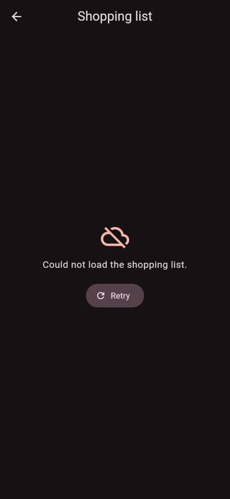
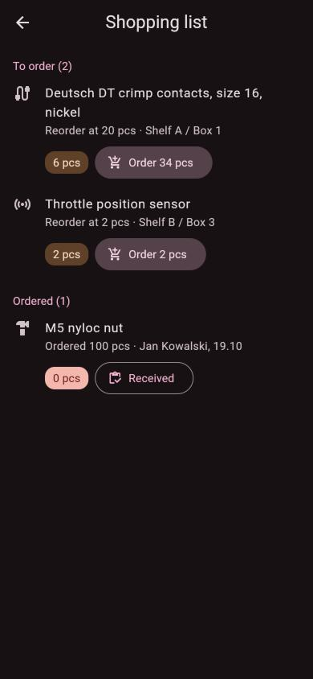
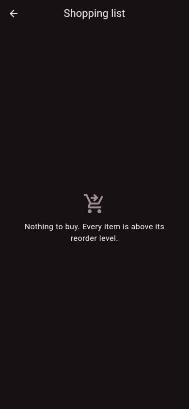
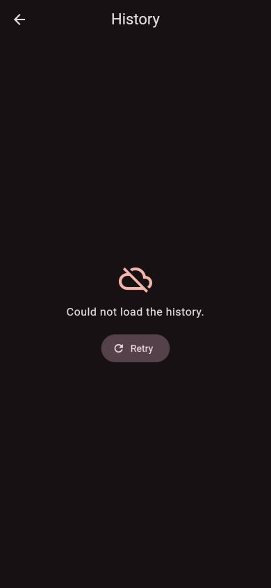
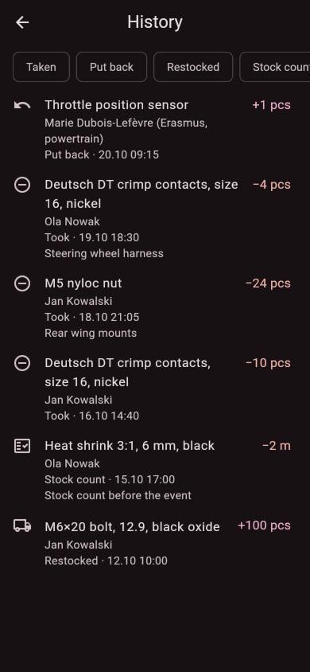

# Lab 2 report: EleStock

Tag: lab-2 · Date: 17.11.2026

## Done
- Layered `lib/`: `domain/` (immutable models), `data/` (repository interfaces and fakes), `ui/` (one folder per feature with its screen and view model)
- Repository interfaces `ItemRepository`, `TransactionRepository`, `OrderRepository` and `AuthRepository`, with fake implementations that use a delay and a simulated failure rate
- One state-management approach: provider + ChangeNotifier, justified in the README (`## Architecture`)
- All 8 main screens from the project card, each fed by a view model: login, profile and settings, inventory, item form, item details, scanner, history, shopping list
- App shell with a `NavigationBar` on phones and a `NavigationRail` on wide screens
- Loading, empty and error-with-retry states on every screen with data
- Shared state through `ItemRepository.itemUpdates`: "Take 4" on item details updates the inventory list, the history and the shopping list without a reload
- Item form with validation (create and edit)
- Take / put back with a validated quantity dialog, an optimistic update and a rollback when saving fails
- Unit tests for every view model, each with at least one failure path, and widget tests for every screen, including the error states
- CI: format, analyze and test on every push

## Who did what
| Member | Work | Pull requests |
| --- | --- | --- |
| Grosse | Login (Supabase Auth), app shell, profile and settings; network permissions for login on Android | [#11](https://github.com/karolgrosse/EleStock/pull/11), [#13](https://github.com/karolgrosse/EleStock/pull/13) |
| Weindich | Inventory view model, item form; CI fixes, narrow-window fix, shared team conventions, macOS network permission | [#7](https://github.com/karolgrosse/EleStock/pull/7), [#8](https://github.com/karolgrosse/EleStock/pull/8), [#3](https://github.com/karolgrosse/EleStock/pull/3), [#4](https://github.com/karolgrosse/EleStock/pull/4), [#5](https://github.com/karolgrosse/EleStock/pull/5), [#12](https://github.com/karolgrosse/EleStock/pull/12) |
| Koczorowska | Repository interfaces and fake repository, item details view model, take / put back, scanner screen, `ErrorView`; Lab 2 report | [#2](https://github.com/karolgrosse/EleStock/pull/2) |
| Szulik | History screen and view model, shopping list with orders, architecture section in the README | [#6](https://github.com/karolgrosse/EleStock/pull/6), [#9](https://github.com/karolgrosse/EleStock/pull/9), [#10](https://github.com/karolgrosse/EleStock/pull/10) |

## Screenshots

Shopping list in all four states:

| Loading | Error | Loaded | Empty |
| --- | --- | --- | --- |
|  |  |  |  |

History in all four states:

| Loading | Error | Loaded | Empty |
| --- | --- | --- | --- |
|  |  |  |  |

## Tests

`flutter test`:

```
00:14 +99: All tests passed!
```

66 unit tests and 33 widget tests (the lab asks for 8 and 3).

## Problems and solutions
- **CI went red after the first Lab 2 merges** (formatting, analyzer warnings, an outdated `pubspec.lock`). Fixed in #5, which also pins the Flutter version in CI.
- **The app crashed in very narrow windows.** Fixed in #4: below 320 px the app keeps a minimum width instead of overflowing.
- **Supabase login failed in release builds** because Android and macOS block network access by default. Fixed by adding the permissions in #13 (Android) and #12 (macOS).
- **Four people editing shared files in parallel** (`main.dart`, the repository interfaces). We agreed on the repository interfaces first (#2) and wrote shared conventions (#3), so the other features were built on the same view model pattern and the same `itemUpdates` stream.
- **No GitHub issues or milestones were created**, so the work was tracked through pull requests only. They will be created before Lab 3.

## Changes to the scope
- **Login uses Supabase Auth already** (planned for Lab 3). Without Supabase keys the app falls back to fake accounts, so it still runs and is testable offline.
- **The shopping list has orders**: an item can be marked as ordered and, when it arrives, received, which restocks it and records a transaction. This adds an `OrderEntry` model and an `OrderRepository`.
- **The scanner is a tab in the app shell** and also opens from the inventory app bar. It accepts a typed item id until real QR scanning arrives in Lab 4.

## Plan for the next lab
- **Grosse:** go_router with `/items/:id`, redirect to login when logged out, sync status in profile
- **Weindich:** drift database (offline-first) and repositories on top of it
- **Koczorowska:** stock computed from transactions
- **Szulik:** Supabase tables and services, sync queue with conflict handling
- **All:** create the GitHub issues and milestones for Labs 3 and 4
